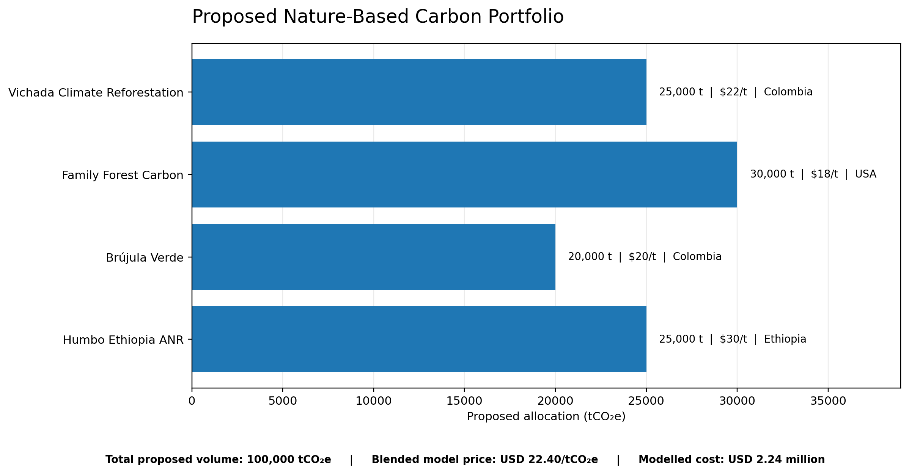

# 01. Nature-Based Carbon Portfolio Construction

## 1. Objective

Develop a defensible portfolio of nature-based carbon removal credits for a hypothetical corporate buyer, Astra Consumer Products.

The portfolio was designed against the following procurement requirements:

- Total volume: 100,000 tCO₂e
- Eligible vintages: 2021–2025
- Maximum blended price: USD 35/tCO₂e
- Project count: 3–5
- Geographic concentration: maximum three countries
- Eligible standards: Verra VCS or Gold Standard
- Credit status: issued credits only

Project selection also considered additionality, conservative carbon quantification, permanence, biodiversity and community outcomes, and reputational risk.

## 2. Portfolio Screening and Selection

Four projects were selected across three countries and two principal restoration pathways: afforestation/reforestation (ARR), improved forest management (IFM), and assisted natural regeneration (ANR).

## 3. Project Selection Rationale

### Vichada Climate Reforestation – Colombia

Selected for its reported multi-vintage issuance, conservation commitments and documented biodiversity and community outcomes. The project reports threatened species conservation, protected land and employment benefits.

**Accepted risk:** Fire exposure in a savanna landscape and the presence of plantation species alongside native species.

**Further checks:** Firebreak maintenance records and confirmation of eligible, issued and available credits.

### Family Forest Carbon – USA

Selected as the portfolio's lower-cost improved forest management component. Its conservation agreements, longer-rotation management approach and monitoring documentation provide a basis for assessing carbon delivery.

**Accepted risk:** Harvesting remains permitted, creating a need to examine long-term carbon storage and reversal management.

**Further checks:** Reconcile reported removals, buffer deductions and issued-credit availability.

### Brújula Verde – Colombia

Selected to diversify the Colombian ARR allocation and incorporate additional project-quality evidence, including a BeZero AA.pre assessment.

**Accepted risk:** Eucalyptus-dominated initial planting and discrepancies between reported monitoring and issuance figures.

**Further checks:** Reconcile issuance and buffer volumes, verify eligible credits and examine implementation of community benefit-sharing arrangements.

### Humbo Ethiopia ANR – Ethiopia

Selected for its community-managed assisted natural regeneration approach and reported restoration, biodiversity, water and livelihood benefits.

**Accepted risk:** Historical concerns relating to grazing access and community benefit-sharing, alongside a higher assumed credit price.

**Further checks:** Verify safeguards, community participation, benefit-sharing and availability of eligible, unretired 2021-vintage credits.

## 4. Vintage Allocation

The proposed allocation is distributed across eligible vintages from 2021 to 2025, based on the vintage and issuance evidence recorded in the supporting workbook.

The vintage allocation is a planning decision, not confirmation that all proposed credits are currently available for purchase. Registry records and credit serial numbers must be checked before contracting.

## 5. Pricing Methodology

Project-level prices are model assumptions informed by available market references, project characteristics and assessed quality considerations.

The resulting blended price is:

**USD 2,240,000 / 100,000 tCO₂e = USD 22.40/tCO₂e.**

The model remains below the USD 35/tCO₂e procurement ceiling. Assumed prices are not confirmed seller quotations.

## 6. Procurement Conditions

Before contracting, the buyer should confirm:

- Current registry status and credit issuance.
- Eligible vintage and credit serial numbers.
- Unretired and transferable credit availability.
- Reconciliation of monitoring, verification and buffer deductions.
- Evidence supporting carbon quantification and permanence.
- Implementation of biodiversity and community safeguards.

## 7. Important Limitations

This portfolio is a proposed procurement model based on the documentary and registry evidence reviewed for the assessment. It is not a completed purchase, an independent carbon-credit verification or a guarantee of future credit delivery.

See the accompanying workbook for allocation calculations, vintage evidence, pricing assumptions and project-level decision rationale.
